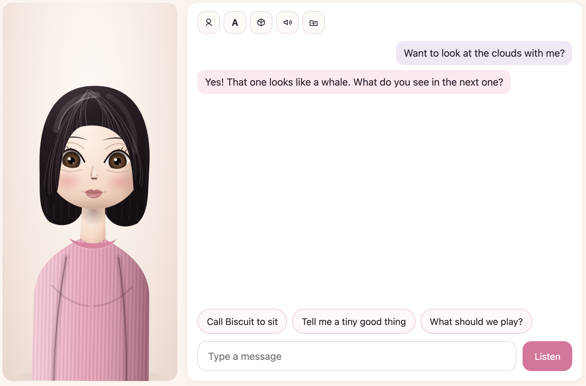
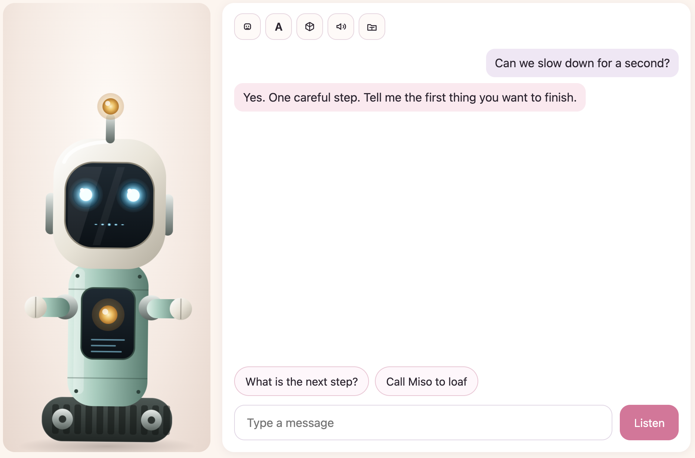
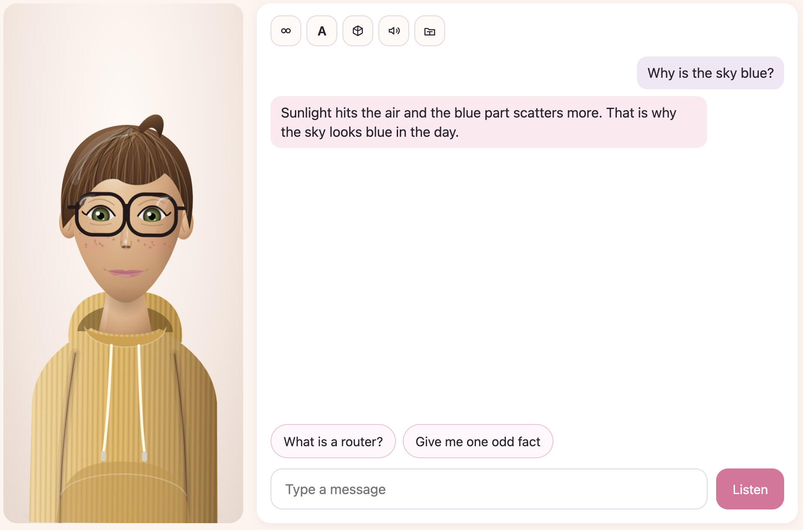
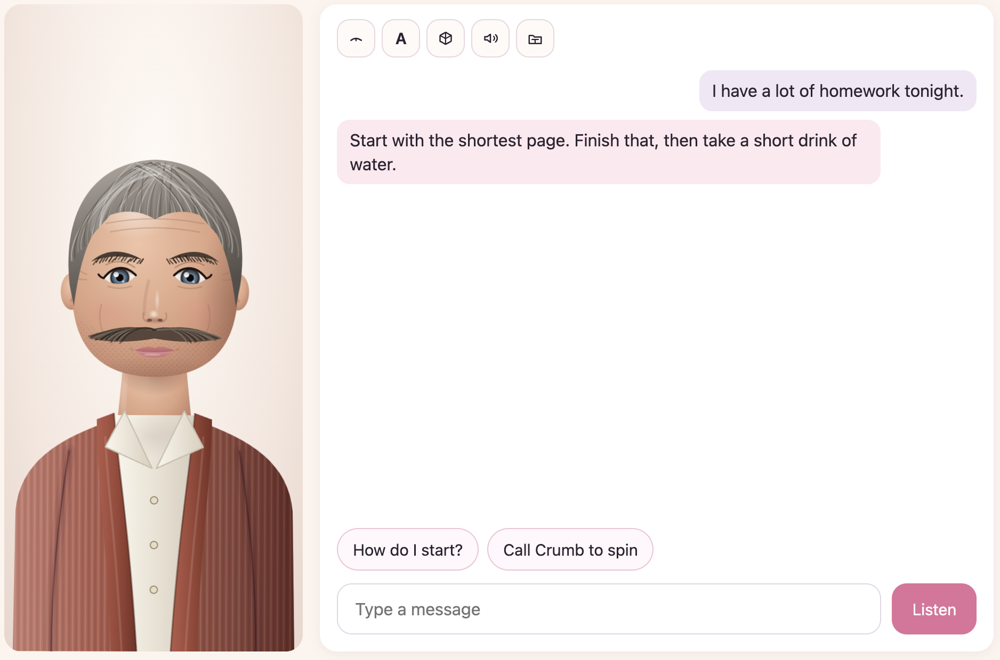

# Lumi

Lumi is a local macOS companion. She chats through Ollama on this machine and listens with click-to-talk. English replies are spoken with Ollama's Phonon voices (Freya for Lumi, Easton for Milo, Hugh for Hank), and Pip is spoken by eSpeak NG, a small robot-sounding synthesizer. Tamil replies are spoken with Piper voices: Hema Latha for Lumi, Rasa for Milo and Pip, and Valluvar for Hank. English replies keep a short breath inside the sentence and a brief pause between sentences. The personality menu changes who is in the window: Lumi, Pip the helper robot, Milo the study buddy, or Hank the careful dad. Each one has their own voice. Nothing in a conversation is sent to a cloud API.



This build is the conversation itself. A later build can add a wake word. Opening apps, reading files, and reminders come after that.


Pip, Milo, and Hank each keep their own chat:

| Pip | Milo | Hank |
| --- | --- | --- |
|  |  |  |

## What you need

- An Apple Silicon Mac.
- [Ollama](https://ollama.com), with at least one chat model pulled. `gemma4:latest` is the default.
- Node.js and Rust. The Tauri CLI is installed by `npm install`.

## Run it

From the repo root:

```bash
./run.sh
```

That script checks this Mac, installs Node, Rust, Ollama, and uv with Homebrew when one of them is missing, runs `npm install`, starts Ollama if it is not already answering, and pulls `gemma4:latest` when no chat model is installed. It also sets up the human voice (see below). It then opens the window. Running it again is safe and quick.

You can still start the window yourself with `npm install` and `npm run tauri dev` after those tools are in place. If Ollama is not already running, Lumi also starts `ollama serve` and waits up to 20 seconds. The text box stays disabled, with the line you typed still in it, until a chat model is available.

The first launch downloads the missing speech packs into `~/Library/Application Support/com.lumi.companion/models`:

- Whisper Small English, for English listening
- IndicConformer Tamil, for Tamil listening
- Kokoro English, with the Bella and Sky voices. This is the small built-in voice, used while the human voice is warming up or if it is unavailable.

You can type as soon as Ollama is ready, including while those downloads are still going. The download line shows each pack. If one fails, click Retry. English Listen stays off until Whisper Small English is ready. The first launch downloads that model, about 600 MB. Tamil Listen stays off until IndicConformer is ready, about 190 MB. Bella and Sky stay off until Kokoro is ready. If a saved voice is missing and Bella is ready, English speech uses Bella. The three Tamil voices download too, about 63 MB each. If one is missing, eSpeak NG speaks Tamil instead. An English reply in Tamil mode is spoken with the English voice, so the Tamil voice is not asked to read English.

## The human voice

`./run.sh` also installs eSpeak NG (`brew install espeak-ng`) for Pip, and pulls Ollama's [Phonon](https://ollama.com/library/phonon) speech model (about 112 MB, once; it needs Ollama 0.40.9 or later). The app asks Ollama's `/v1/audio/speech` endpoint for each sentence, so there is no separate voice server. Nothing leaves the Mac after the download. If Phonon is missing, the built-in voice speaks. `LUMI_SKIP_VOICE=1` skips the pull.

- It needs about a minute to warm up after the window opens. Until then, and if it ever fails, the Kokoro voice speaks instead.
- A reply is voiced one sentence group at a time, so the first words start after a few seconds. It runs a little slower than real speech, so a long reply can pause briefly between sentences.
- To change who sounds like whom, edit `voice_name` in `crates/lumi-core/src/phonon.rs`. `ollama show phonon` lists every voice.
- `LUMI_SKIP_VOICE=1 ./run.sh` skips the voice setup. If setup fails, `./run.sh` says so and opens Lumi anyway. Run it again to retry.

Allow the microphone when macOS asks. The prompt says: "Lumi uses the microphone so you can talk to her."

## Use it

- Type a message and press Enter. The box clears right away. The reply streams into the transcript, then Lumi speaks it.
- Click Listen once. Talk, then pause for about a second. Lumi answers, then listens again. You do not click for each turn. Click Stop when you want the conversation to end.
- Sending another message while a reply is playing stops that voice. If Listen is still open, listening starts again after the new reply. The partial reply stays in the transcript.
- Personality, language, and model apply to the next turn. The personalities are Lumi, Pip the helper robot, Milo the study buddy, and Hank the careful dad. Each one remembers only their own conversation and speaks with their own voice: Lumi, Milo, and Hank use Phonon (Freya, Easton, and Hugh), and Pip uses eSpeak NG. The voice cannot be changed. Tamil uses a Piper voice for each of them (Hema Latha for Lumi, Rasa for Milo and Pip, Valluvar for Hank) when the reply is in Tamil script, and answers in Tamil. Embedding models are hidden.
- Quit and reopen. The personality, language, model, voice, and each character's conversation remain.
- Click **Backup folder** and pick Google Drive, a USB stick, or any other folder. After each turn Lumi copies the four chats there as readable notes (`Lumi.md`, `Pip.md`, `Milo.md`, `Hank.md`) plus `memories.json`. Nothing is uploaded to a cloud API; Drive only syncs if you pointed at its folder.

## When something goes wrong

| What happened | What you see |
| --- | --- |
| A speech pack did not download | The pack's name, and Retry. Typing still works if Ollama is up. |
| Ollama does not answer | "Ollama is unavailable." The text box waits. |
| No chat model is installed | "No chat model is installed." The text box waits. |
| The microphone is denied | "The microphone is unavailable." Listen stays off. Typing still works. |
| Whisper heard nothing | "It did not catch anything." |
| Tamil is selected and IndicConformer is still downloading | "Tamil is still loading." Listen stays off. |
| The voice could not be spoken | The written reply stays. "She could not speak." |

## Tests

```bash
cargo test -p lumi-core --lib
npm test
```

`npm test` checks the chat-box rules. The Rust tests cover settings, prompts, the transcript, model choice, one chat turn, and the Ollama request. They do not open the microphone or start Ollama.
